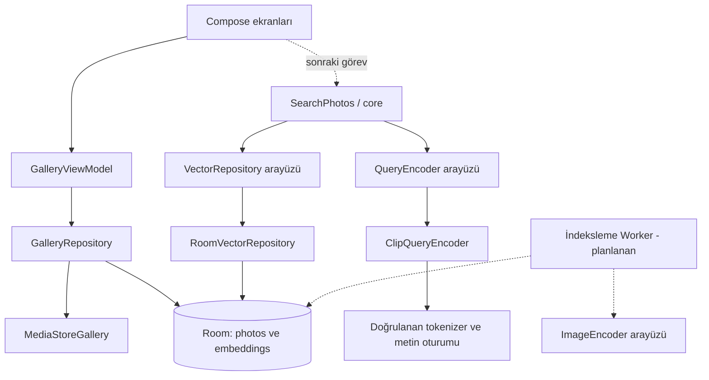

# Mimari kararları

Tarih: 26 Ekim 2026. Kapsam: tek geliştirici, Android, Kotlin.

## Kesinleşen kararlar

| Konu | Karar | Gerekçe |
|---|---|---|
| Platform | Native Android, Kotlin; minSdk 26, compile/targetSdk 36 | Tek platform ve dar geliştirme kapsamı |
| Arayüz | Compose + ViewModel + StateFlow | Ekran durumunun tek yönde yönetilmesi |
| Modüller | `app` ve Android bağımsız `core` | Arama algoritmasını cihaz olmadan test edebilmek |
| Bağımlılık yönetimi | Başlangıçta elle kurulan Application bileşenleri | Küçük projede ek DI altyapısına gerek olmaması |
| Galeri | MediaStore, URI tabanlı erişim | Dosya yolu varsayımlarından kaçınmak |
| Saklama | Room; ayrı fotoğraf ve embedding tabloları | Katalog ile anlamsal indeksin karışmaması |
| Arama | Normalize vektörlerde kosinüs benzerliği, kesin top-k | İlk sürümde ölçülebilir ve açıklanabilir yöntem |
| Görsel analiz | Hazır görsel-metinsel model, indeksleme aşamasında | Sıfırdan model eğitimi kapsam dışı |
| Ağ | Fotoğraflar sunucuya gönderilmeyecek | Yerel çalışma hedefi |
| İş sırası | Tek atomik görev, doğrulama ve sonuç; ardından sonraki görev | Küçük, incelenebilir değişiklikler |

İlk arama uygulaması O(N log K) zaman ve yüklü vektörler için O(ND) bellek kullanır. 512 boyutlu float32 vektör varsayımıyla 10.000 fotoğrafın ham vektörleri yaklaşık 19,5 MiB tutar; Kotlin nesneleri ve veritabanı ek yükü bu hesaba dahil değildir. Büyük galeriler için sayfalı vektör okuma ve alternatif indeks ancak ölçümden sonra ele alınacak.

## Model kararı ve doğrulama kapısı

Kullanıcı A04'te **standart çok dilli CLIP** seçeneğini seçti: `sentence-transformers/clip-ViT-B-32-multilingual-v1` metin kodlayıcısı ve onunla hizalı `sentence-transformers/clip-ViT-B-32` görsel kodlayıcısı. Çeviri katmanı eklenmeyecek. Çalıştırma hedefi ONNX Runtime Android; model dosyaları ve çalışan adaptör henüz uygulamaya bağlanmadı. Türkçe sorgu ayrıntıları A07 ile uygulanan `ClipQueryEncoder` adaptöründe tutulur; ekran/Worker henüz bu adaptörü çağırmaz.

Görsel ve metin kodlayıcıları aynı uyumlu uzayda olmalıdır. Çok dilli metin kodlayıcısı önceki MobileCLIP2-S0 görsel kodlayıcısıyla eşleştirilmeyecek. A03'teki inceleme [önceki aday arşivinde](MOBILECLIP_MODEL_CONTRACT.md) korunur; seçilen çiftin A04.2 [etkin sözleşmesi](MODEL_CONTRACT.md) ve [kaynak/kurallar manifesti](MODEL_CONTRACT.json) hazırdır. Sabit kaynaklar ve karar [A04 karşılaştırmasında](A04_TURKISH_QUERY_OPTIONS.md), deney protokolü [değerlendirme planında](EVALUATION_PLAN.md) bulunur.

Model indirmeden veya ana entegrasyonu yazmadan önce:

1. Model kaynağı, sürümü, SHA-256 değeri ve lisansı kaydedilecek.
2. Girdi boyutu, normalizasyon, renk sırası, EXIF yönü ve tokenizer referans uygulamayla eşleştirilecek.
3. Sabit örneklerde Python/reference ve Android çıktılarının sayısal uyumu kontrol edilecek.
4. Gerçek cihazda model boyutu, yükleme süresi, tepe bellek ve fotoğraf başına süre ölçülecek.
5. Türkçe sorgu setinde erişim başarımı değerlendirilecek.

ML Kit görsel analizini arama anında çalıştırmayacağız. PDF'deki ML Kit ifadesinin kapsamına ilişkin belirsizliği artırmamak için başlangıç planı ML Kit çevirisine de bağımlı değildir. Model dağıtımına karar verilene kadar "ilk kurulum dahil tamamen çevrimdışı" iddiası yapılmaz. Mevcut uygulama INTERNET izni istemez.

## A03 model referansı kararı — 23 Kasım 2026

Kullanıcıya OpenCLIP referansı, PicQuery uygulamasını birebir izleme ve iki akışı ayrı deneyle karşılaştırma seçenekleri sunuldu. Kullanıcı **OpenCLIP referans akışını** seçti. Mevcut MobileCLIP2-S0 + eşleşen metin kodlayıcısı adayı korunur; girdiler sabit dışa aktarma deposunun Python/OpenCLIP referansına göre hazırlanacaktır. PicQuery'nin küçük görseller için dolgu ve tüm BPE birleştirmelerini okuma davranışları birebir taşınmayacaktır.

Sabit sürümler, kaynaklar, beklenen ONNX I/O tanımları ve doğrulama sınırları [önceki aday sözleşmesinde](MOBILECLIP_MODEL_CONTRACT.md), SHA-256 kayıtları [önceki kaynak manifestinde](MODEL_REFERENCES.json) bulunur. Bu karar model entegrasyonunu tamamlamaz; gerçek ONNX dosya özetleri ve Android sayısal uyumu A05/A06 sırasında doğrulanacaktır. Türkçe sorgu işleme yaklaşımı A04 kapsamında kalır; 23 Kasım 2026 ödev incelemesiyle kapsam doğrudan çok dilli modelleri de içerecek şekilde netleştirildi.

## A04 model seçimi ve değerlendirme protokolü

Kullanıcı üç alternatif arasından standart çok dilli CLIP çiftini seçti. Ayrı çeviri modeli kullanılmayacak. Metin tarafında tokenizer -> DistilBERT -> masked mean pooling -> 768/512 Dense -> normalizasyon; görsel tarafında eşleşen CLIP processor ve projeksiyon korunacak. Görsel A05 ve metin A06 prototipleri aşağıdaki sınırlarla doğrulandı; galeri/arama bağlantısı henüz uygulanmadı.

Görsel ön işleme, token kimlikleri, hedef I/O ve sayısal toleranslar [etkin model sözleşmesinde](MODEL_CONTRACT.md) sabitlendi. A05/A06 gerçek model dosyaları ve Android çıktılarıyla bu kuralları doğrulamadan tamamlanmaz. Mevcut arama algoritması veya Room şeması bu seçim kaydıyla değiştirilmedi. Geliştirme/test ayrımı, veri seti gerekçeleri ve ölçümler [EVALUATION_PLAN.md](EVALUATION_PLAN.md) dosyasında tanımlıdır.

## Bileşenler

`SearchPhotos` görsel encoder'a veya MediaStore'a bağımlı değildir. Böylece sorgu sırasında fotoğraf inference'ı çağırma yolu bulunmaz. Sadece metin kodlama ve saklanmış vektörler kullanılır.

## Galeri arayüzünün dosya sınırları

- `MainActivity`: edge-to-edge pencereyi ve Compose içeriğini başlatır.
- `GaleriAraTheme`: mevcut Material temasını ve renk şemasını tanımlar.
- `GalleryRoute`: ViewModel bağlantısı, izin isteği, uygulama ayarlarına yönlendirme ve ON_RESUME yenilemesini yönetir.
- `GalleryScreen`: aldığı ekran durumu ve olay callback'leriyle sayfayı çizer; seçili fotoğrafın geçici önizleme durumunu tutar.
- `GalleryUiState`: ekran durumunu tanımlar; `GalleryViewModel`: mevcut yükleme ve iptal akışını yönetir.
- `GalleryAccessCard`, `PhotoGrid`, `PhotoPreviewDialog`: erişim kartı, küçük görsel listesi ve önizleme penceresini ayrı ayrı çizer.

Bu ayrım yeni bir mimari yaklaşım eklemez; mevcut davranışı onaylanan dosya sınırlarına taşır. Veri katmanı ve arama çekirdeği bu düzenlemenin kapsamı dışındadır.

## Veri ve geçerlilik

- `photos`: URI birincil anahtar; görünen ad, değişiklik zamanı ve boyut.
- `embeddings`: fotoğraf URI'si, model kimliği, revision, boyut ve float32 vektör baytları. Fotoğraf kaydı silinince bağlı vektör silinir.
- `revision`, model ağırlıkları, tokenizer ve görsel ön işleme ayarlarının ortak sözleşme sürümünü temsil eder.
- Değişiklik zamanı veya boyut değişince mevcut vektörler geçersizleştirilir. Aynı zaman ve boyutta yapılan içerik değişikliklerini saptamak bu ilk yöntemin bilinen sınırıdır.
- Tam ve başarılı katalog taraması sonrası erişilebilir kapsamdan çıkan kayıtlar kaldırılır. Sınırlı izinde bu durum fiziksel silinme olarak yorumlanmaz. Yeniden izin verilince tekrar indeksleme gerekebilir.
- İzin reddedilince ekrandaki liste temizlenir. Gelecek arama adaptörü sonuçları güncel erişilebilir URI kapsamıyla sınırlandırmalıdır; yalnızca eski DB kaydına güvenemez.

## Planlanan indeksleme yaşam döngüsü

WorkManager ile tek benzersiz iş, başlangıçta tek görsel inference işlemi. Kalıcı iş durumu ve hata kayıtları, modeli bağlama görevi sırasında şemaya eklenecek. Başarılı her fotoğrafın vektörü atomik kaydedilecek; yarıda kesilen iş tamamlanmış vektörleri yeniden üretmeyecek. Bozuk fotoğraf atlanabilir; model yükleme hatası bütün işin başarısızlığı olarak ele alınmalı. Coroutine iptali genel hata olarak yutulmamalı.

Mevcut sürümde Worker çalışmaz ve galeri için kalıcı embedding üretilmez; A05 tek kontrollü görsel için test çıkarımı üretir. WorkManager bağımlılığı sonraki indeksleme görevi için tanımlıdır.

## Akademik değerlendirme

- Başlangıç deney önerisi: kullanım izni alınmış 200-500 fotoğraf ve nesne, sahne, renk, ilişki kategorilerinden en az 30 Türkçe sorgu. Bunlar zorunlu belge koşulları değil, önerilen deney boyutlarıdır.
- Her sorgu için ilgili fotoğraflar elle işaretlenecek; Recall@5/10, Precision@5 ve sıralama için nDCG@10 hesaplanacak.
- Etiket tabanlı arama karşılaştırma yöntemi olarak ayrı deneyde ele alınacak.
- İlk indeksleme süresi, artımlı güncelleme süresi, model yükleme, sorgu kodlama ve vektör sıralama süreleri ayrı raporlanacak. Arama için p50/p95, bellek ve indeks boyutu ölçülecek.
- Sayısal başarı eşikleri model deneyi öncesinde belirlenecek; ölçülmemiş performans sonuçları rapora yazılmayacak.
- Akademik ön rapor, PDF'nin bölüm ve biçim koşullarına göre hazırlanacak; bu teknik belge raporun yerine geçmez. Kaynak gereksinimleri, bölüm eşlemesi ve kullanıcı tarafından önerilen 27 Aralık 2026 planlama hedefine göre takvim [ödev ve rapor planında](ASSIGNMENT_REQUIREMENTS.md) kayıtlıdır. Tarih kesin ders teslim tarihi olarak varsayılmaz.

## Ödev belgesiyle ilişki - 23 Kasım 2026

PDF, PicQuery'yi incelenebilecek bir bağlantı olarak verir; aynı modeli veya çeviri yöntemini şart koşmaz. Kullanıcı da bunun yalnız referans olduğunu doğruladı. Temel özgünlük koşulları fotoğrafların önceden analiz edilip Türkçe istemlerle eşleşen indeks oluşturulması ve arama sırasında ML Kit gibi araçların dinamik kullanımına ihtiyaç duyulmamasıdır. ML Kit ifadesi, sorgu zamanı çeviri kullanımına otomatik uygunluk gerekçesi sayılmayacak; seçilen yaklaşımın bu koşulla ilişkisi açıkça belgelenecektir.

Literatürdeki alternatifler, veri seti adayları ve deney planı geliştirme boyunca toplanacak; use case ve teknolojileri gösteren component çizimleri son rapora eklenecek. PDF koşulları ile proje tercihlerinin ayrımı [ASSIGNMENT_REQUIREMENTS.md](ASSIGNMENT_REQUIREMENTS.md) dosyasındadır. Bu kayıt yeni bir model seçimi veya uygulama mimarisi değişikliği değildir.

## Kaynaklar

1. [PicQuery](https://github.com/greyovo/PicQuery): `lib/src/engine/indexer.dart`, `translator.dart`, `lib/src/managers/search_manager.dart`. İnceleme tarihi 26 Ekim 2026; master değişebilir. Model entegrasyonu öncesi referans commit sabitlenecek.
2. [Android seçili fotoğraf erişimi](https://developer.android.com/about/versions/14/changes/partial-photo-video-access).
3. [Room](https://developer.android.com/jetpack/androidx/releases/room).
4. [ONNX Runtime Java/Android](https://onnxruntime.ai/docs/get-started/with-java.html).
5. [AGP 8.13 uyumluluğu](https://developer.android.com/build/releases/agp-8-13-0-release-notes).

## A05 görsel prototipinin sınırı

`data/encoding/ClipImagePreprocessor`, yönü önceden düzeltilmiş Bitmap'i RGB/BICUBIC/merkez kırpma/CLIP normalizasyonu ile Float32 NCHW girdiye dönüştürür. `ClipVisualModel`, doğrulanan SHA-256 ve I/O ile dosyadan ONNX oturumu açar; CPU üzerinde ham 512 boyutlu vektör döndürür, tensör/sonuç/oturum kaynaklarını kapatır. Çağıran taraf arka plan dispatcher'ını seçmelidir. Ortak L2 normalizasyonu `core/Embedding` sınırında kalır.

Bu yardımcılar galeri `ImageEncoder` URI adaptörüne, ViewModel'e, Room'a veya Worker'a bağlanmadı. APK model içermez. Bütün model çiftinin runtime manifesti A06 ile tamamlandı; A07 QueryEncoder aynı kimliği kullanır. [A05 kontrol kaydı](validation/A05_VISUAL_ENCODER.md) tek kontrollü PNG ve API 35 x86_64 CPU doğrulamasını gösterir; fiziksel ARM cihazı, EXIF/decoder ve galeri başarımı çıkarımı yapılmaz.

## A06 metin prototipi ve seçilen varyant

Kullanıcı saf Kotlin WordPiece ve tek U8U8 INT8 dosyasını seçti. `CasedWordPieceTokenizer`, sabit sözlük ve cased BERT kurallarıyla tek sorguyu Int64 token/mask dizilerine dönüştürür. `ClipTextModel`, SHA-256 ve gerçek I/O kontrolüyle açılan oturumdan 768 boyutlu token durumlarını alır; padding dışındaki CLS/SEP dahil maskeli ortalama ve doğrulanan Dense ağırlığıyla ham 512 vektör üretir. Oturum/tensör/sonuç kaynakları sahipleri tarafından kapatılır; arka plan dispatcher'ını çağıran seçer. Ortak L2 `core/Embedding` sınırında kalır.

Etkin dosya `model_quint8_avx2.onnx` U8U8'dir. Önceki ARM64 adlı U8S8 dosyası mevcut x86 CPU'da kabul bütçesini geçmedi; teşhis ARM cihazı ölçümü değildir. U8U8 dosyası masaüstü ve API 35 x86_64 Android üzerinde doğrulandı. Fiziksel ARM uyumu/performansı ve Türkçe retrieval başarımı ayrıca ölçülmelidir; cihaz türüne göre ikinci bir model seçme yolu eklenmedi.

[Runtime manifesti](MODEL_RUNTIME_MANIFEST.json) gerçek görsel/metin/Dense/tokenizer özetleri ve işlem profillerinden ortak revision üretir. Manifestin hazır olması kodlayıcıların uygulamaya bağlandığı anlamına gelmez. A06 prototipi A07 ile `ClipQueryEncoder` arayüz uygulamasına bağlandı; ViewModel, Room ve Worker henüz çağırmaz. Model dağıtımı ve URI/decoder doğrulaması sonraki ilgili görevlerde kalır. [A06 kaydı](validation/A06_TEXT_ENCODER.md) ve [çalıştırma araçları](../tools/README.md) ölçüm sınırlarını açıklar.

## A07 sorgu adaptörü ve kaynak sahipliği

Kullanıcının son seçimi adaptör başına tek ONNX oturumudur. `ClipQueryEncoder.open(ClipTextFiles)` yalnız doğrulanan dosyalardan bir örnek oluşturur; Application singleton'ı veya otomatik model indirmesi eklemez. Örneği oluşturan çağıran sahibi olur; iş bittiğinde `close()` çağırır. Aynı örnekteki sorgular iptal edilebilir Mutex kuyruğuyla sıralanır. Native çalışma ve kapatma ortak yaşam döngüsü kilidiyle ayrılır; kapatma idempotenttir ve mevcut çalışmayı bekler. Kapatma bloklayıcı olduğundan ana iş parçacığı dışında yapılmalıdır.

Dosya yükleme/özet doğrulama IO, tokenizer/model/L2 işlemleri Default dispatcher'dadır. Manifest kimliği `MultilingualClipProfile` içinde sabittir; bileşen değişikliği ortak manifest ve profil güncellemesi gerektirir. Normalizasyon `core/Embedding` ile yapılır. Girdi Türkçe casing'ini korur; çeviri ve ek normalizasyon katmanı yoktur. Hata ve CancellationException yutulmaz; açılış sırasında iptal edilirse oluşturulan native kaynak kapatılır.

İptal kooperatiftir: kuyruk çağrısı iptal edilebilir; tokenizasyon öncesi/sonrası ve native çıktı sonrası iptal denetlenir. Devam eden native çağrı zorla kesilmez; iptal edilmiş sonuç teslim edilmez ve kaynak çağrı sürerken kapatılmaz. [A07 kaydı](validation/A07_QUERY_ENCODER.md), gerçek QueryEncoder çıktısı ile kontrollü eşzamanlılık/hata testlerini açıklar. Bu adım SearchPhotos/Room/Worker veya arama ekranı kurulumu değildir; A08 kalıcı vektör adaptörüne geçer.

## A08 kalıcı vektör adaptörü

`EmbeddingDao` var olan embeddings tablosuna suspend upsert ve tam model id/revision filtresi ekler. `RoomVectorRepository` mevcut VectorRepository okuma arayüzünü uygular; yazma için `save(photoUri, embedding)` sağlar. Fotoğraf önceden katalogda bulunmalıdır; FK yetim vektörü reddeder. Adaptör veritabanının sahibi değildir, ortak Room örneğini kapatmaz. Fotoğraf kodlama, Worker ve ekran kurulumu bu sınıfın sorumluluğu değildir.

Kayıt Float32 LE, başlıksız ve normalize biçimdedir. Blob tam `dimensions*4` bayt olmalıdır. Okumada `Embedding.fromNormalized` değerleri doğrulayıp kopyalar; ikinci normalizasyonun Float32 bitlerini değiştirmesi önlenir. Ham çıktı constructor'ı önceki tek L2 davranışını korur. Model/ön işleme revision'ı değişmedi. Mevcut tablo, kolon, birleşik anahtar ve FK aynı olduğundan Room sürümü/migration değiştirilmedi.

Kullanıcının seçimi, bozuk byte/norm/boyut kaydında bütün okumayı VectorIntegrityException ile durdurup kaydı korumaktır. Yalnız istenen id/revision seçilir; boyut uyuşmazlığı görünmez bir filtreyle gizlenmez. Yazma transaction'ı, aynı model id/revision altında fotoğraflar arası boyut karışmasını denetler ve sonra upsert yapar. Fotoğraf silme cascade'i ve mevcut invalidate işlemi bütün bağlı revision'ları temizlemeye devam eder.

Serileştirme/çözme Default dispatcher'dadır; suspend DAO ve Room transaction işlemleri Room yürütücülerini kullanır. Okuma mevcut VectorRepository sözleşmesi gereği seçilen modelin tüm satırlarını belleğe alır; büyük galeri sayfalama ve performans ölçümü bu görevde eklenmedi. [A08 kaydı](validation/A08_ROOM_VECTORS.md) gerçek SQLite disk kalıcılığı, veri bütünlüğü, paralel yazma ve A07 regresyonunu gösterir.
