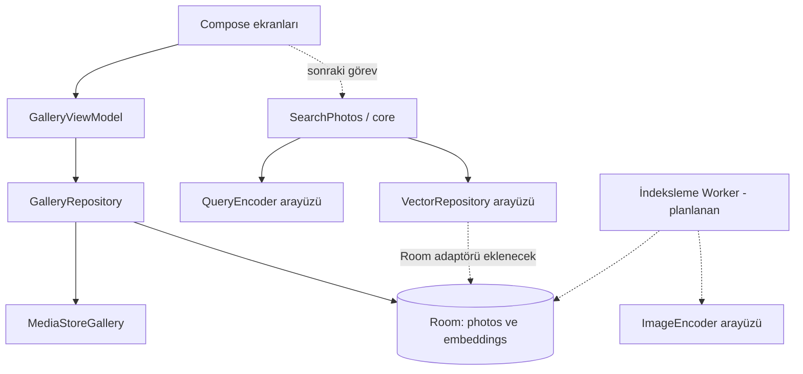

# Mimari kararları

Tarih: 26 Ekim 2026. Kapsam: tek geliştirici, Android, Kotlin.

## Kesinleşen kararlar

| Konu | Karar | Gerekçe |
|---|---|---|
| Platform | Native Android, Kotlin; minSdk 26, compile/targetSdk 36 | Tek platform ve dar geliştirme kapsamı |
| Arayüz | Compose + ViewModel + StateFlow | Ekran durumunun tek yönde yönetilmesi |
| Modüller | `app` ve Android bağımsız `core` | Arama algoritmasını cihaz olmadan test edebilmek |
| Bağımlılık yönetimi | Başlangıçta elle kurulan Application bileşenleri | Küçük projede ek DI altyapısına gerek olmaması |
| Galeri | MediaStore, URI tabanlı erişim | Dosya yolu varsayımlarından kaçınmak |
| Saklama | Room; ayrı fotoğraf ve embedding tabloları | Katalog ile anlamsal indeksin karışmaması |
| Arama | Normalize vektörlerde kosinüs benzerliği, kesin top-k | İlk sürümde ölçülebilir ve açıklanabilir yöntem |
| Görsel analiz | Hazır görsel-metinsel model, indeksleme aşamasında | Sıfırdan model eğitimi kapsam dışı |
| Ağ | Fotoğraflar sunucuya gönderilmeyecek | Yerel çalışma hedefi |
| İş sırası | Tek atomik görev, doğrulama ve sonuç; ardından sonraki görev | Küçük, incelenebilir değişiklikler |

İlk arama uygulaması O(N log K) zaman ve yüklü vektörler için O(ND) bellek kullanır. 512 boyutlu float32 vektör varsayımıyla 10.000 fotoğrafın ham vektörleri yaklaşık 19,5 MiB tutar; Kotlin nesneleri ve veritabanı ek yükü bu hesaba dahil değildir. Büyük galeriler için sayfalı vektör okuma ve alternatif indeks ancak ölçümden sonra ele alınacak.

## Model kararı ve doğrulama kapısı

İlk teknik aday PicQuery ile aynı ailede **MobileCLIP2-S0 görsel + eşleşen metin kodlayıcıları, ONNX Runtime Android**. Bu bir entegrasyon hedefidir; projede model dosyası veya çalışan inference adaptörü henüz yoktur. Türkçe için başlangıç deneyi sorgu çevirisi + eşleşen İngilizce metin kodlayıcısı olacaktır. Çeviri uygulaması ayrı `QueryEncoder` adaptöründe tutulacak.

Çeviri modelinin somut varlığı, tokenizer uyumu, lisansı ve cihaz maliyeti ayrı araştırma görevinin sonucunda seçilecek. PicQuery'nin Çince çeviri modeli Türkçe için kullanılamaz. Görsel ve metin encoder'ı birbirinden bağımsız rastgele modeller olamaz. Doğrudan çok dilli alternatif, başlangıç adayı kabul ölçütlerini karşılamazsa değerlendirilecek.

Model indirmeden veya ana entegrasyonu yazmadan önce:

1. Model kaynağı, sürümü, SHA-256 değeri ve lisansı kaydedilecek.
2. Girdi boyutu, normalizasyon, renk sırası, EXIF yönü ve tokenizer referans uygulamayla eşleştirilecek.
3. Sabit örneklerde Python/reference ve Android çıktılarının sayısal uyumu kontrol edilecek.
4. Gerçek cihazda model boyutu, yükleme süresi, tepe bellek ve fotoğraf başına süre ölçülecek.
5. Türkçe sorgu setinde erişim başarımı değerlendirilecek.

ML Kit görsel analizini arama anında çalıştırmayacağız. PDF'deki ML Kit ifadesinin kapsamına ilişkin belirsizliği artırmamak için başlangıç planı ML Kit çevirisine de bağımlı değildir. Model dağıtımına karar verilene kadar "ilk kurulum dahil tamamen çevrimdışı" iddiası yapılmaz. Mevcut uygulama INTERNET izni istemez.

## Bileşenler

`SearchPhotos` görsel encoder'a veya MediaStore'a bağımlı değildir. Böylece sorgu sırasında fotoğraf inference'ı çağırma yolu bulunmaz. Sadece metin kodlama ve saklanmış vektörler kullanılır.

## Veri ve geçerlilik

- `photos`: URI birincil anahtar; görünen ad, değişiklik zamanı ve boyut.
- `embeddings`: fotoğraf URI'si, model kimliği, revision, boyut ve float32 vektör baytları. Fotoğraf kaydı silinince bağlı vektör silinir.
- `revision`, model ağırlıkları, tokenizer ve görsel ön işleme ayarlarının ortak sözleşme sürümünü temsil eder.
- Değişiklik zamanı veya boyut değişince mevcut vektörler geçersizleştirilir. Aynı zaman ve boyutta yapılan içerik değişikliklerini saptamak bu ilk yöntemin bilinen sınırıdır.
- Tam ve başarılı katalog taraması sonrası erişilebilir kapsamdan çıkan kayıtlar kaldırılır. Sınırlı izinde bu durum fiziksel silinme olarak yorumlanmaz. Yeniden izin verilince tekrar indeksleme gerekebilir.
- İzin reddedilince ekrandaki liste temizlenir. Gelecek arama adaptörü sonuçları güncel erişilebilir URI kapsamıyla sınırlandırmalıdır; yalnızca eski DB kaydına güvenemez.

## Planlanan indeksleme yaşam döngüsü

WorkManager ile tek benzersiz iş, başlangıçta tek görsel inference işlemi. Kalıcı iş durumu ve hata kayıtları, modeli bağlama görevi sırasında şemaya eklenecek. Başarılı her fotoğrafın vektörü atomik kaydedilecek; yarıda kesilen iş tamamlanmış vektörleri yeniden üretmeyecek. Bozuk fotoğraf atlanabilir; model yükleme hatası bütün işin başarısızlığı olarak ele alınmalı. Coroutine iptali genel hata olarak yutulmamalı.

Mevcut sürümde Worker çalışmaz ve embedding üretilmez. WorkManager bağımlılığı sonraki indeksleme görevi için tanımlıdır.

## Akademik değerlendirme

- Başlangıç deney önerisi: kullanım izni alınmış 200-500 fotoğraf ve nesne, sahne, renk, ilişki kategorilerinden en az 30 Türkçe sorgu. Bunlar zorunlu belge koşulları değil, önerilen deney boyutlarıdır.
- Her sorgu için ilgili fotoğraflar elle işaretlenecek; Recall@5/10, Precision@5 ve sıralama için nDCG@10 hesaplanacak.
- Etiket tabanlı arama karşılaştırma yöntemi olarak ayrı deneyde ele alınacak.
- İlk indeksleme süresi, artımlı güncelleme süresi, model yükleme, sorgu kodlama ve vektör sıralama süreleri ayrı raporlanacak. Arama için p50/p95, bellek ve indeks boyutu ölçülecek.
- Sayısal başarı eşikleri model deneyi öncesinde belirlenecek; ölçülmemiş performans sonuçları rapora yazılmayacak.
- Akademik ön rapor bu teknik belgeden üretilecek; bu dosya final rapor değildir. Teslim tarihi bilinmediği için tarihli takvim henüz oluşturulmadı.

## Kaynaklar

1. [PicQuery](https://github.com/greyovo/PicQuery): `lib/src/engine/indexer.dart`, `translator.dart`, `lib/src/managers/search_manager.dart`. İnceleme tarihi 26 Ekim 2026; master değişebilir. Model entegrasyonu öncesi referans commit sabitlenecek.
2. [Android seçili fotoğraf erişimi](https://developer.android.com/about/versions/14/changes/partial-photo-video-access).
3. [Room](https://developer.android.com/jetpack/androidx/releases/room).
4. [ONNX Runtime Java/Android](https://onnxruntime.ai/docs/get-started/with-java.html).
5. [AGP 8.13 uyumluluğu](https://developer.android.com/build/releases/agp-8-13-0-release-notes).
